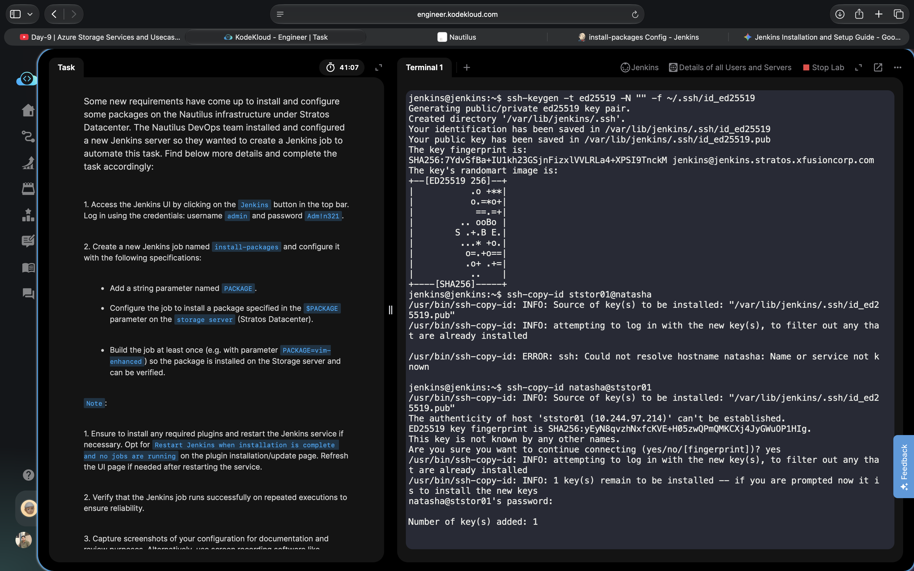
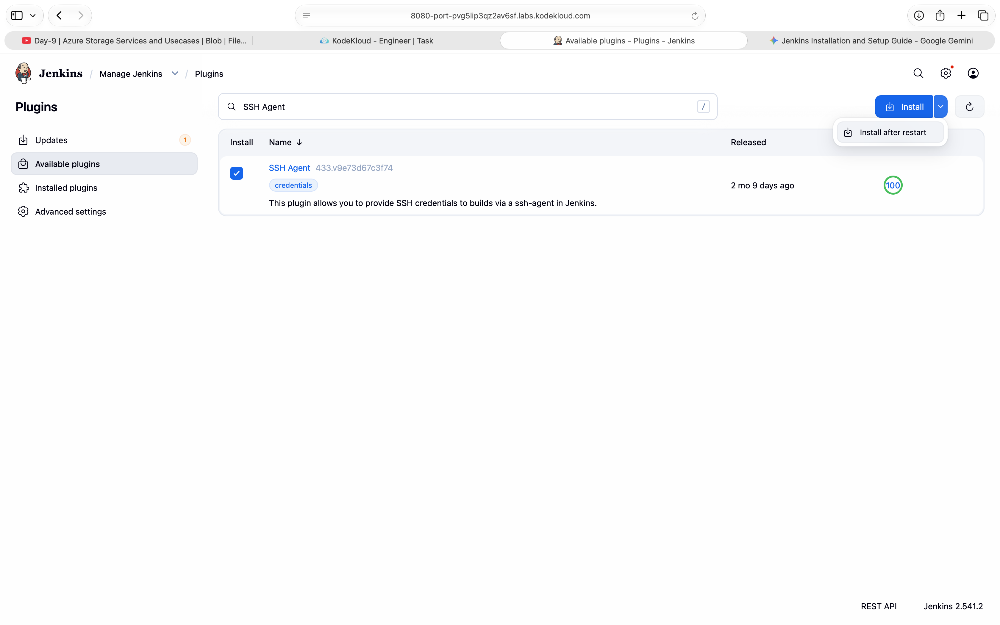
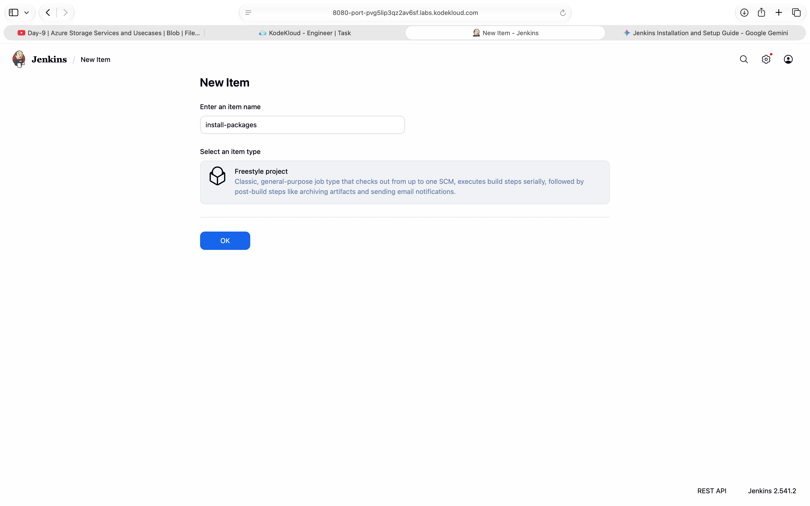
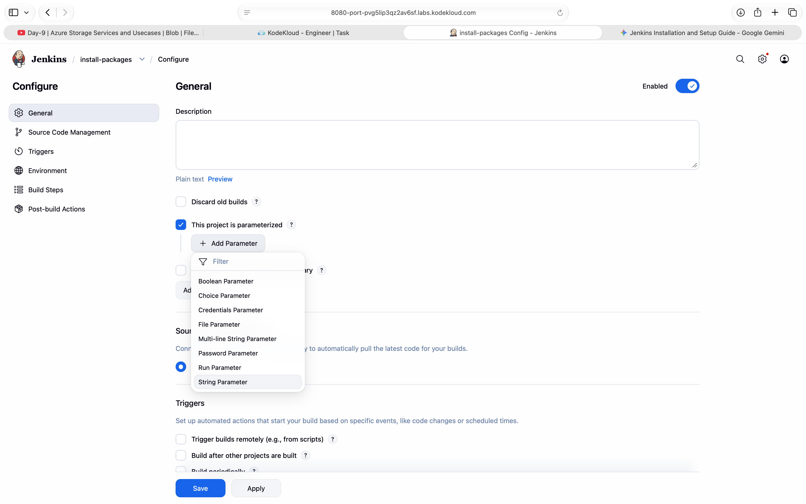
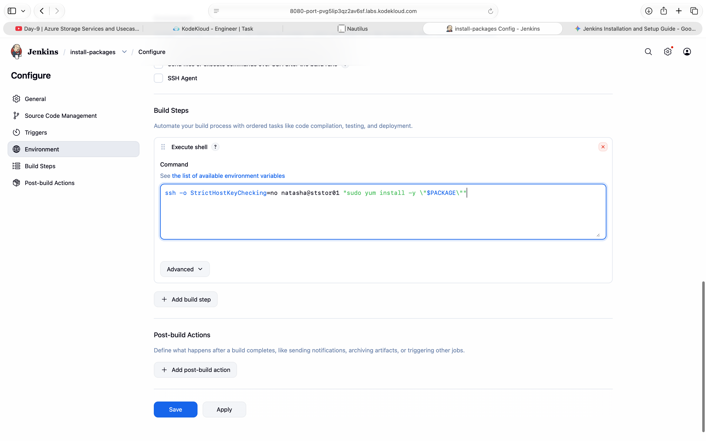
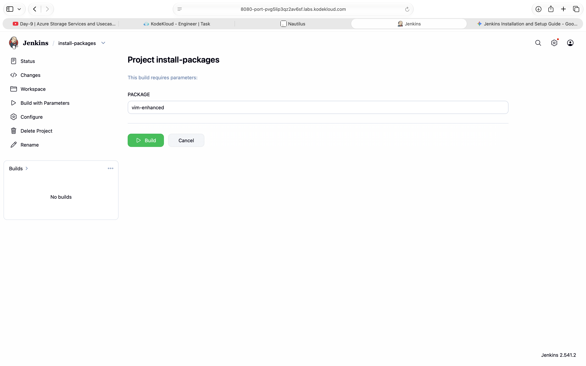
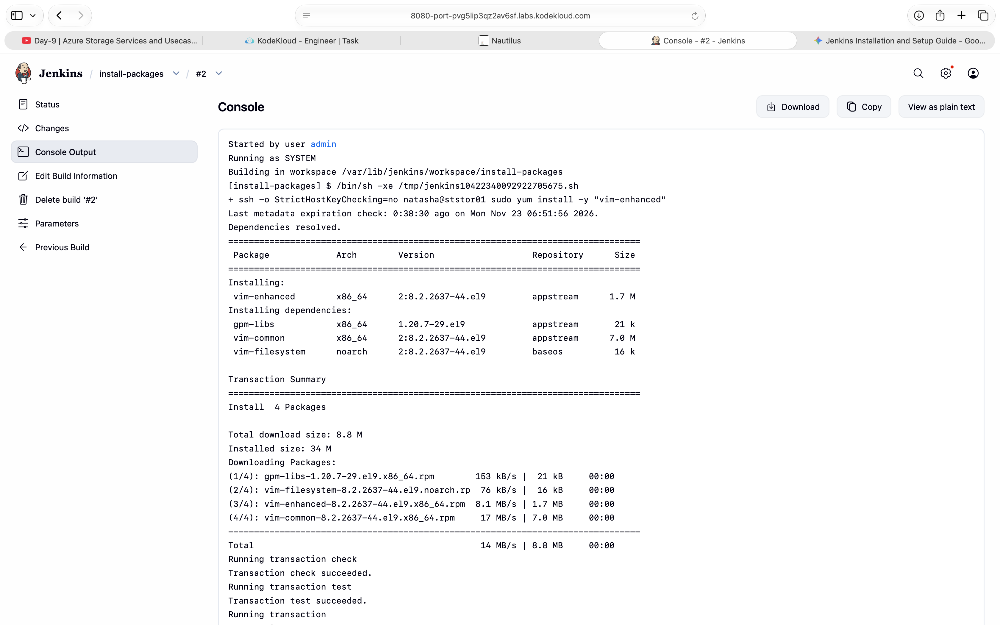
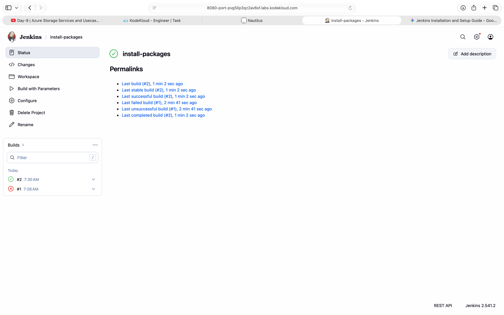

Some new requirements have come up to install and configure some packages on the Nautilus infrastructure under Stratos Datacenter. The Nautilus DevOps team installed and configured a new Jenkins server so they wanted to create a Jenkins job to automate this task. Find below more details and complete the task accordingly:


1. Access the Jenkins UI by clicking on the Jenkins button in the top bar. Log in using the credentials: username admin and password Adm!n321.


2. Create a new Jenkins job named install-packages and configure it with the following specifications:


Add a string parameter named PACKAGE.

Configure the job to install a package specified in the $PACKAGE parameter on the storage server (Stratos Datacenter).


Build the job at least once (e.g. with parameter PACKAGE=vim-enhanced) so the package is installed on the Storage server and can be verified.


Note:

1. Ensure to install any required plugins and restart the Jenkins service if necessary. Opt for Restart Jenkins when installation is complete and no jobs are running on the plugin installation/update page. Refresh the UI page if needed after restarting the service.


2. Verify that the Jenkins job runs successfully on repeated executions to ensure reliability.


3. Capture screenshots of your configuration for documentation and review purposes. Alternatively, use screen recording software like loom.com for comprehensive documentation and sharing.

# Solution : 

## 1. SSH into Jenkins server, generate keygen and transfer into Storage Server. 
```
ssh jenkins@jenkins
ssh-keygen -t ed25519 -N "" -f ~/.ssh/id_ed25519

ssh-copy-id natasha@ststor01
```


## 2. Open Jenkins UI and install SSH Agent 


## 3. Create a new job called install-packages --> Configure --> String Parameter --> vim-enhanced



## 4. Install-package Job --> Configure --> Execute Shell
```
ssh -o StrictHostKeyChecking=no natasha@ststor01 "sudo yum install -y \"$PACKAGE\""
```


## 5. Start the job with build parameter (vim-enhanced)


## 6. Verify the task. 

