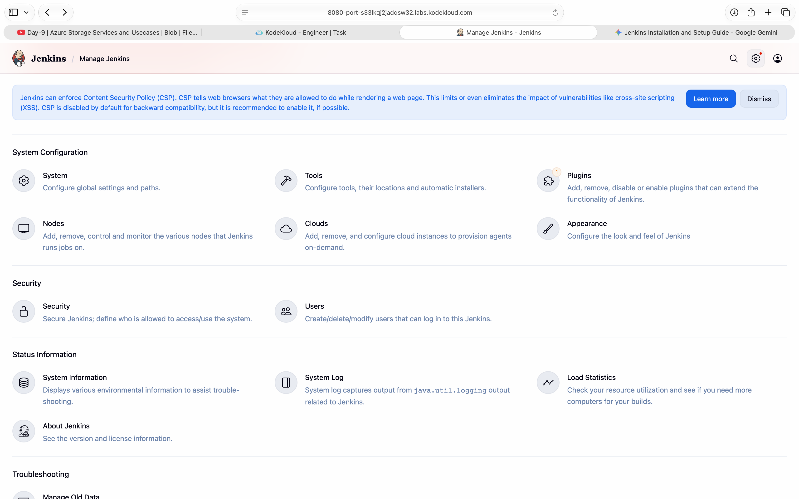
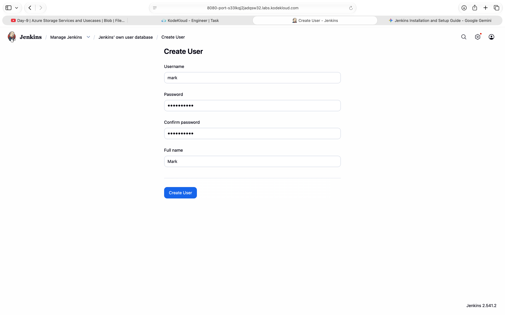
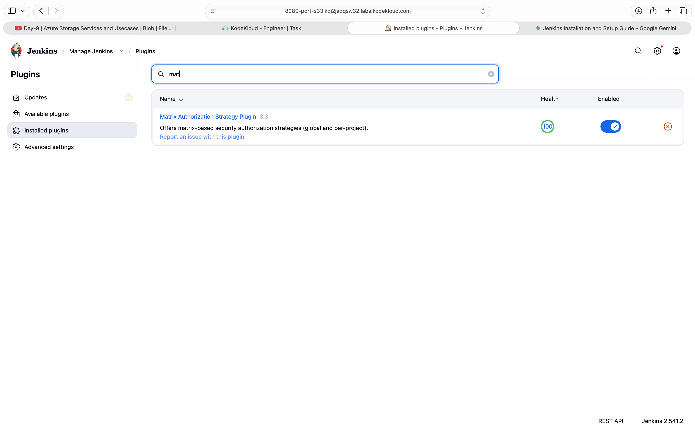
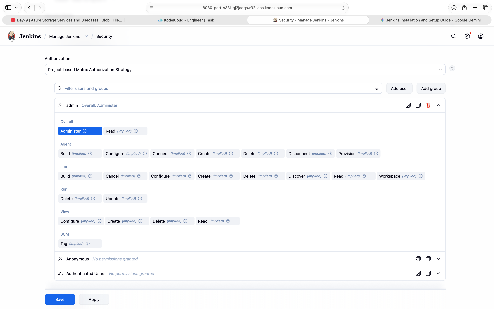
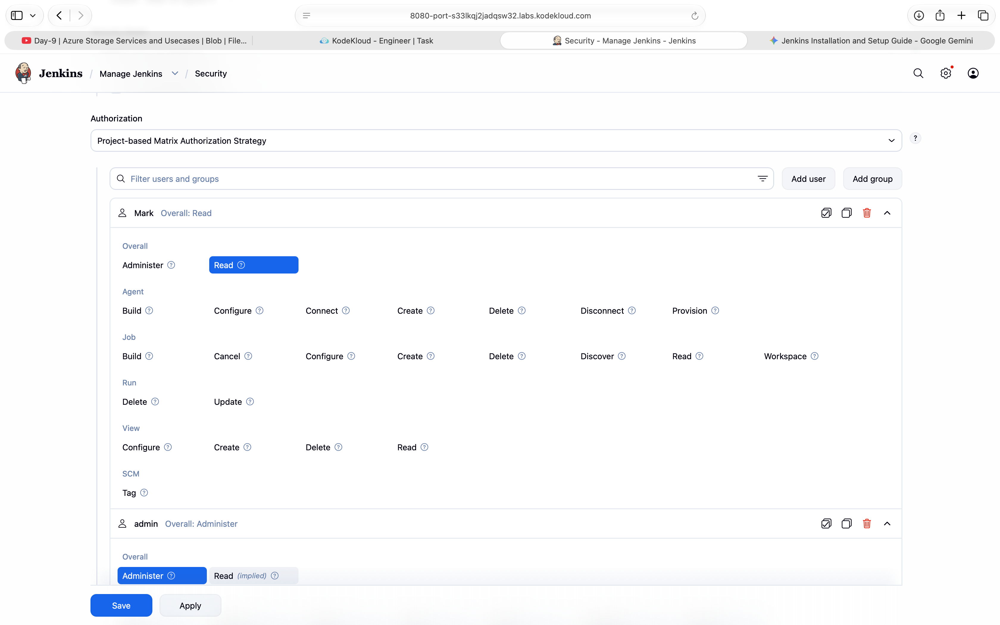
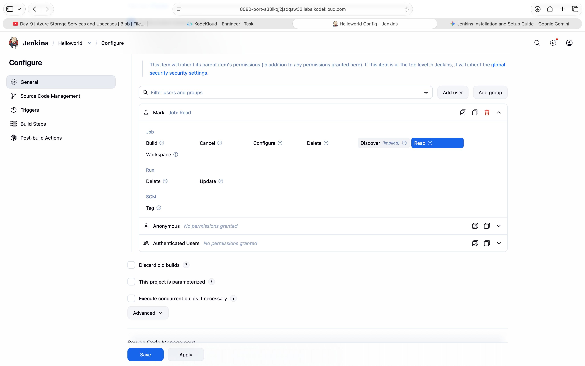

configuring user access for the development team, Follow these steps:

1. Click on the Jenkins button on the top bar to access the Jenkins UI. Login with username admin and password Adm!n321.

2. Create a jenkins user named mark with the password Rc5C9EyvbU. Their full name should match Mark.

3. Utilize the Project-based Matrix Authorization Strategy to assign overall read permission to the mark user.

4. Remove all permissions for Anonymous users (if any) ensuring that the admin user retains overall Administer permissions.

5. For the existing job, grant mark user only read permissions, disregarding other permissions such as Agent, SCM etc.

Note:

1. You may need to install plugins and restart Jenkins service. After plugins installation, select Restart Jenkins when installation is complete and no jobs are running on plugin installation/update page.

2. After restarting the Jenkins service, wait for the Jenkins login page to reappear before proceeding. Avoid clicking Finish immediately after restarting the service.

3. Capture screenshots of your configuration for review purposes. Consider using screen recording software like loom.com for documentation and sharing.

# Solution : 

## 1. Login to the jenkin server UI then go to settings --> users. 

## 2. Create a user named mark. 

## 3. Install plugin named Matrix Authorization Strategy.

## 4. Setting --> Under Securtiy --> Authorization --> Choose Project Based Strategy --> Create user named admin give adminstrator access & Create user named mark give overall read access. 

## 5. Configure the build --> Enable Project Based Security --> Add user named mark grant read permissions. 
