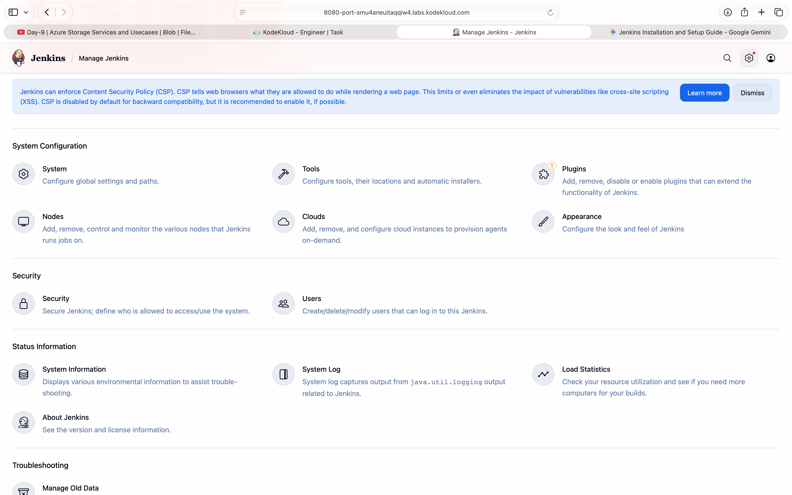
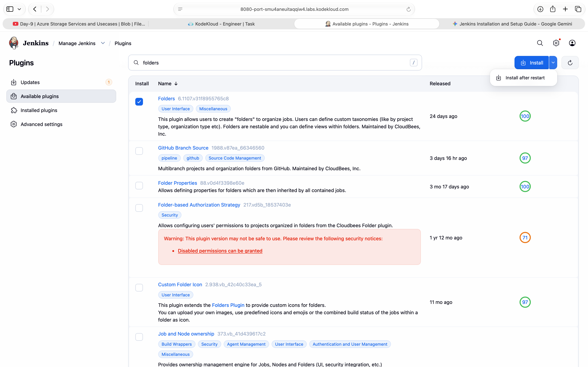
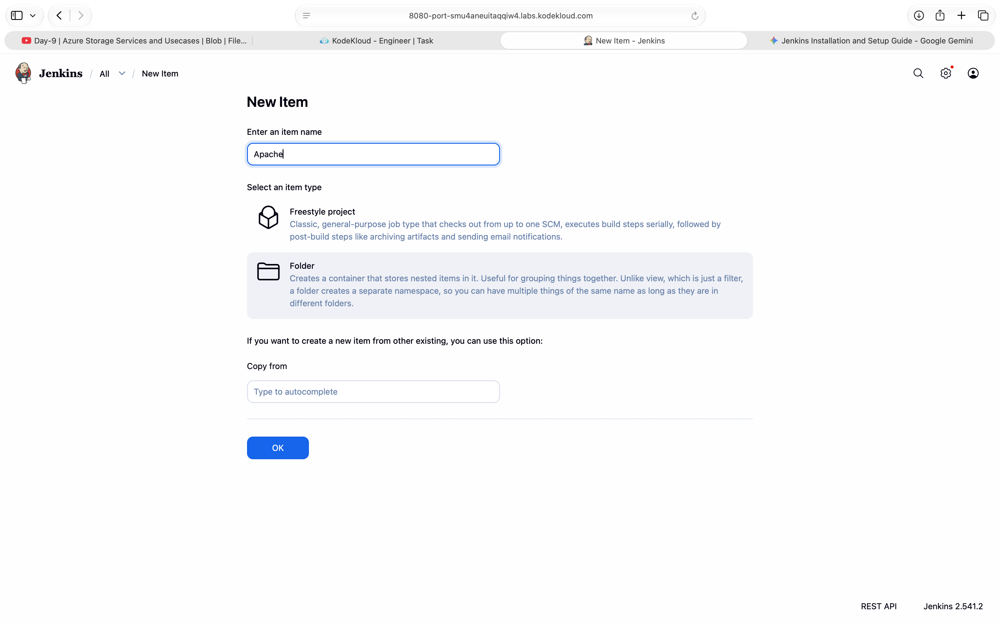
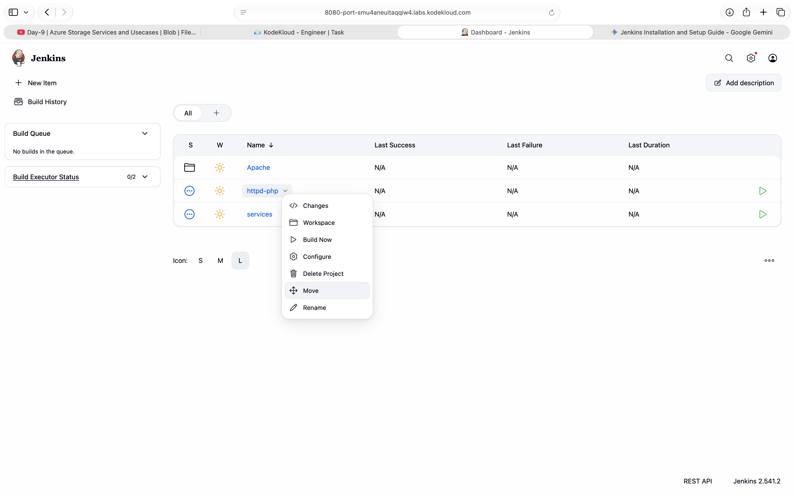
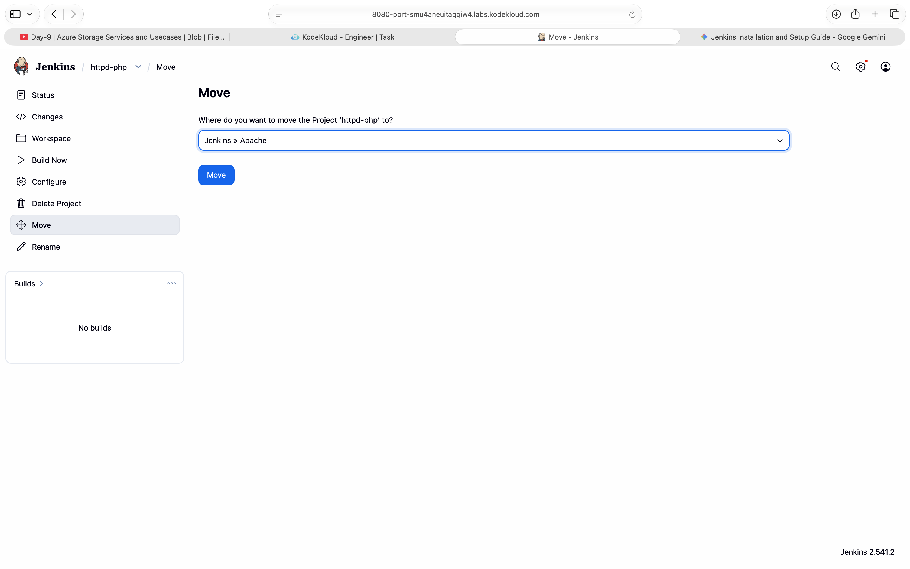

xFusionCorp Industries' DevOps team aims to streamline the management of Jenkins jobs by organizing them into distinct folders based on their purpose. Complete the task following the provided requirements:

1.Access the Jenkins UI by clicking on the Jenkins button in the top bar. Log in using the credentials: username admin and password Adm!n321.

2. Create a new folder named Apache within the Jenkins UI.

3. Move the existing jobs httpd-php and services under the newly created Apache folder.

Note:

1. Ensure to install any required plugins and restart the Jenkins service if necessary. Opt for Restart Jenkins when installation is complete and no jobs are running on the plugin installation/update page.

2. Be aware that Jenkins UI may experience temporary unresponsiveness during the service restart. Refresh the UI page if needed.

3. Capture screenshots of your work for documentation and review purposes. Alternatively, utilize screen recording software like loom.com for detailed documentation and sharing.

# Solution : 

## 1. Login into the jenkins server and go to the setting --> plugins.

## 2. Inside the plugins tab, find Folders plugin in available plugins section then install after restart.

## 3. On the jenkins dashboard --> New Item --> Folder --> Name (Apache). 

## 4. Move the jobs that are in the dashobard to folder named apache.

